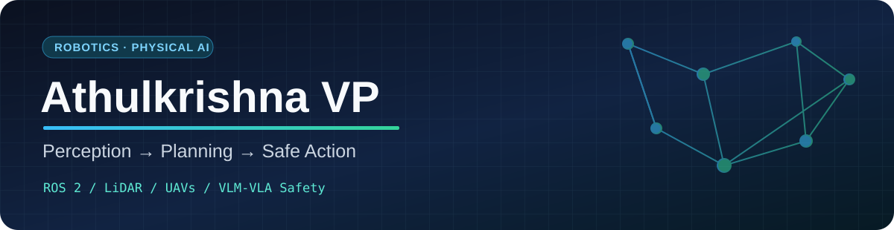

**Robotics · Physical AI · Autonomous Navigation · UAVs · Perception · Robot Safety**

## 👋 About Me

I'm **Athulkrishna VP**, a robotics engineer and **M.Eng. Mechatronics and Cyberphysical Systems** student at **Deggendorf Institute of Technology** in Germany. My work connects robot perception, autonomous planning, and foundation-model reasoning with practical safety mechanisms for real-world robotic systems.

- 🤖 **Physical AI & safety:** researching knowledge- and constitution-guided safety monitoring for robot motion and Vision-Language-Action (VLA) systems at **Schaeffler**.
- 🚁 **Autonomous UAVs:** developed LiDAR-based plane detection, 3D mapping, path planning, and simulated precision landing at **Universität der Bundeswehr München**.
- 🧭 **Navigation:** build ROS-based mobile robots and 3D planners using **A\***, **RRT/RRT\***, point clouds, and occupancy maps.
- 🦾 **Hands-on robotics:** experience with humanoid robots, robotic arms, embedded controllers, and vision-driven interaction.
- 🔎 **Interested in:** full-time robotics, robot perception, autonomous systems, and Physical AI engineering opportunities.

## 🛠️ Technical Toolbox

**Robotics, planning & simulation**

**AI, perception & safety**

**Development & hardware**

## 🚀 Featured Projects

### 01 · Constitutional Safety Brain — Robot Safety Monitoring

**Python · SigLIP · PyTorch · VLMs · Semantic Retrieval · Constitutional AI**

Designed a safety-monitoring pipeline that matches robot camera frames against **63 constitutional safety rules**, using visual–text embeddings for fast first-pass screening. Built rule-level hazard scoring and an evaluation interface for comparing detection and reasoning behavior.

- Benchmarked an approximately **137 ms** SigLIP screening path against a **34.9 s** Qwen-VL reasoning path in the documented experiment (about **255×** faster in that comparison).
- Exploring graph-guided safety checks, selective higher-level reasoning, and explainable interventions for robot control.

🎥 [Watch the demonstration](https://youtube.com/watch?v=MK_gFOnhCw8)

### 02 · Safety-Aware Vision-Language-Action Controller

**Python · RoboBrain2.5 · V-JEPA · VLMs · Risk Visualization**

Built an experimental **three-stage safety-gated pipeline** for screening robot commands and candidate trajectories. Combined constitution-based command checks with model-assisted trajectory assessment and visual risk overlays. Created an evaluation UI for investigating safety decisions and debugging scenarios.

🎥 [Watch the demonstration](https://youtu.be/Ehb461TiQHI)

### 03 · Autonomous Drone Landing on Cargo Boxes

**ROS · LiDAR · Python · RRT · Unreal Engine · RViz**

Developed a simulated autonomous landing workflow that uses LiDAR point clouds to identify cargo boxes, estimate landing targets, and plan obstacle-aware routes to their centers. Integrated a custom RRT-based planning library with visualization and flight simulation.

🎥 [Watch the demonstration](https://youtu.be/JImVHIX0O0U)

### 04 · Landing Assist Module (LAM)

**ROS 2 · AirSim · Unreal Engine · Open3D · OctoMap · RANSAC / PROSAC**

Explored safe UAV landing-zone detection from 3D point clouds, including planar-surface detection, occupancy mapping, and simulation-driven evaluation.

📂 [Source code — Landing Assist Module](https://github.com/athulkrishnaaei/Landing-Assist-Module-LAM)

### 05 · ROS-Based Autonomous Mobile Robot

**ROS · RPLIDAR · Jetson Nano · Arduino Nano · Flask**

Built a LiDAR-equipped mobile robot with environment mapping, distributed motor control, and a browser interface for goal selection, remote operation, and live system monitoring.

🎥 [Watch the demonstration](https://youtube.com/shorts/nsJ0YgHIQi0)

### 06 · Humanoid Robot with Hand Tracking

**Computer Vision · Gesture Interaction · Robotics**

Contributed to a humanoid platform that follows hand movement in real time and supports gesture-responsive interaction, question answering, and line following.

🎥 [Watch the demonstration](https://youtu.be/STopG6v4R4s)

<b>More projects</b>

- **Edge AI Apple Classification & Pneumatic Sorting** — YOLOv5, Raspberry Pi, Arduino, MQTT, and pneumatic actuation; ongoing tracking and timing improvements.
- **IoT Smart Extension Board** — Internet-connected control of three devices, voice assistants, mobile controls, and Telegram integration. [Demo](https://youtu.be/RJqJeY4B5Eo)
- **Electric Cycle** — lithium-ion / BLDC-motor project with a reported 25 km range and 40 km/h top speed. [Demo](https://youtu.be/SsaXQv5LV0E)
- **Hand Gesture Controlled Robotic Arm** — OpenCV gesture tracking mapped to servo motion. [Demo](https://youtu.be/gQuPhFFletc)

## 💼 Experience

| Organization | Role | Period |
|---|---|---|
| **Schaeffler Technologies AG & Co. KG** | Master thesis student ,Safety Brain for Humanoid Robots: Knowledge-Graph-Guided Safety Monitoring For Motion Control  | AUG 2026 – Present |
| **Schaeffler Technologies AG & Co. KG** | Behavioral Safety Research Intern, Innovation Factory | Sep 2025 – Mar 2026 |
| **Universität der Bundeswehr München** | Student Research Assistant — UAV perception & planning | Jun 2024 – May 2025 |
| **Robomiracle** | Robotics Trainer & Research Specialist | Feb 2023 – Aug 2023 |

At Robomiracle, I helped teach hands-on robotics, programming, 3D printing, and drone technology to **2,000+ students**.

## 🎓 Education

| Degree | University | Period |
|---|---|---|
| **M.Eng. Mechatronics and Cyberphysical Systems** | Deggendorf Institute of Technology, Germany | Mar 2025 – Present |
| **B.Tech. Mechanical Engineering** | PRIST University, India | Mar 2018 – Aug 2022 |

## 📬 Let's Connect

I'm interested in collaborations on **safe embodied intelligence, robot perception, autonomous navigation, planning, and UAV systems**.

📧 **Email:** [athulkrishnavpkdlr47@gmail.com](mailto:athulkrishnavpkdlr47@gmail.com)  
🐙 **GitHub:** [github.com/athulkrishnaaei](https://github.com/athulkrishnaaei)  
📍 **Based in Germany**

---

Engineering autonomy with perception, planning, and safety in the loop.

